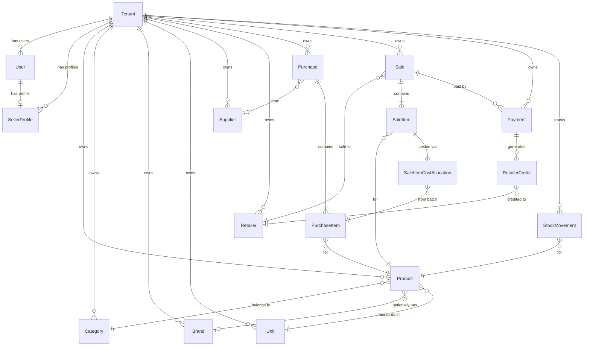

<p align="center">
  <h1 align="center">📦 StockLedger</h1>
  <p align="center">
    <strong>Multi-Tenant Inventory & Billing Management System</strong>
  </p>
  <p align="center">
    A production-grade REST API built with Django REST Framework that enables wholesale distributors to manage inventory, process sales with FIFO cost tracking, handle partial payments, and generate PDF invoices — all within a tenant-isolated architecture.
  </p>
  <p align="center">
    <a href="#features">Features</a> •
    <a href="#the-problem">The Problem</a> •
    <a href="#architecture">Architecture</a> •
    <a href="#tech-stack">Tech Stack</a> •
    <a href="#api-reference">API Reference</a> •
    <a href="#getting-started">Getting Started</a>
  </p>
</p>

<br>

## The Problem

Small-to-medium wholesale distributors across India still rely on **handwritten registers** or **disconnected spreadsheets** to manage stock, track customer credit, and generate invoices. This leads to:

| Pain Point | Business Impact |
|---|---|
| **No real-time stock visibility** | Overselling, stock-outs, and lost revenue |
| **Manual invoice generation** | Human error in pricing, totals, and record-keeping |
| **No cost tracking (FIFO)** | Inability to calculate true profit margins per sale |
| **Credit management chaos** | Forgotten debts, disputed balances, and cash flow problems |
| **Single-user systems** | A distributor's entire business depends on one person's notebook |

**StockLedger** solves these problems by providing a multi-tenant API backend where **each seller gets an isolated workspace** with complete control over their catalog, inventory, customers, and billing — while a **Super Admin** can oversee all tenants from a single dashboard.

<br>

## Features

### 🏢 Multi-Tenant Architecture
- **Tenant isolation** at the database row level — every query is automatically scoped to the authenticated user's tenant
- **Role-based access control** with `SUPER_ADMIN` (platform-level) and `SELLER` (tenant-level) roles
- Super Admins can manage all tenants, create new sellers, and access cross-tenant data
- Sellers can only see and modify data within their own tenant

### 📦 Product Catalog Management
- Full CRUD for **Products**, **Categories**, **Brands**, and **Units** of measurement
- Per-tenant uniqueness constraints (e.g., two tenants can both have a category named "Beverages")
- Configurable **low stock thresholds** per product for automated alerts
- SKU support and active/inactive product status

### 📥 Purchase & Stock Management
- Record purchases with multiple line items per order
- **Supplier management** with contact details
- Each purchase automatically creates a **FIFO inventory layer** (`PurchaseItem.remaining_quantity`)
- Every stock change is tracked via **StockMovement** records for a complete audit trail
- Automatic total calculation for purchase orders

### 🧾 Sales & Invoicing
- Create sales invoices with auto-generated sequential invoice numbers (`INV-YYYYMMDD-000001`)
- **FIFO cost allocation** — when a sale is made, stock is consumed from the oldest purchase batches first
- `SaleItemCostAllocation` records track exactly which purchase batches funded each sale item
- Full **invoice editing** support with automatic reversal and re-application of FIFO allocations
- **PDF invoice generation** using WeasyPrint with a professionally styled HTML template

### 💰 Payment Tracking
- Record partial or full payments against invoices
- Automatic payment status derivation: `UNPAID → PARTIAL → PAID`
- **Overpayment handling** — excess payments are automatically stored as `RetailerCredit` and added to the customer's credit balance
- Date-range filtering for payment queries
- Nested endpoint: `POST /api/sales/{id}/payments/` for recording payments directly against an invoice

### 👥 Customer (Retailer) Management
- Manage retailers/customers with shop details, contact info, and addresses
- Per-tenant phone uniqueness constraint
- **Credit balance tracking** — automatically maintained when overpayments occur
- Active/inactive status for customer lifecycle management

### 📊 Business Reports
Seven built-in report endpoints covering critical business intelligence:

| Report | Endpoint | Description |
|---|---|---|
| **Current Stock** | `GET /api/reports/current-stock/` | Real-time stock levels with low stock flags |
| **Stock Valuation** | `GET /api/reports/stock-valuation/` | Inventory value based on remaining purchase costs |
| **Daily Sales** | `GET /api/reports/daily-sales/?date=` | Revenue, invoice count, and payment summary for a specific date |
| **Monthly Sales** | `GET /api/reports/monthly-sales/?year=` | Month-over-month sales trends for a year |
| **Retailer Dues** | `GET /api/reports/retailer-dues/` | Outstanding balances ranked by amount owed |
| **Purchase History** | `GET /api/reports/purchase-history/` | Purchase data grouped by product or date range |
| **Low Stock Alerts** | `GET /api/reports/low-stock/` | Products below their configured threshold |

### 🔐 Authentication & Authorization
- **JWT authentication** using `djangorestframework-simplejwt`
- Token refresh support for seamless session management
- Custom permission classes: `IsSuperAdmin`, `IsSeller`, `IsSuperAdminOrSeller`, `IsSuperAdminOrReadOnly`
- Every endpoint is protected — no anonymous access

### 📄 Interactive API Documentation
- **Swagger UI** at `/api/docs/` — powered by `drf-spectacular`
- **ReDoc** at `/api/redoc/` — alternative documentation view
- OpenAPI 3.0 schema at `/api/schema/`

<br>

## Architecture

### System Design

```
┌─────────────────────────────────────────────────────────────────┐
│                        API Layer (DRF)                          │
│  ┌──────────┐ ┌──────────┐ ┌──────────┐ ┌──────────┐           │
│  │ accounts │ │ catalog  │ │  sales   │ │ reports  │  ...       │
│  │  views   │ │  views   │ │  views   │ │  views   │           │
│  └────┬─────┘ └────┬─────┘ └────┬─────┘ └────┬─────┘           │
│       │             │            │             │                │
│  ┌────┴─────────────┴────────────┴─────────────┴─────────────┐  │
│  │                    Service Layer                           │  │
│  │  AccountService · PurchaseService · SaleService            │  │
│  │  PaymentService · InvoiceService · ReportService           │  │
│  │  PDFService                                                │  │
│  └────┬──────────────────────────────────────────────────────┘  │
│       │                                                         │
│  ┌────┴──────────────────────────────────────────────────────┐  │
│  │                    Data Layer (ORM)                        │  │
│  │  TenantScopedModel → automatic tenant FK on all models    │  │
│  │  TimeStampedModel  → created_at / updated_at              │  │
│  └───────────────────────────────────────────────────────────┘  │
│                              │                                  │
│                    ┌─────────┴──────────┐                       │
│                    │    PostgreSQL DB    │                       │
│                    └────────────────────┘                       │
└─────────────────────────────────────────────────────────────────┘
```

### Key Design Decisions

#### 1. Service Layer Pattern
Business logic lives in dedicated `services.py` files — **not** in views or serializers. This enforces:
- **Separation of concerns** — views handle HTTP, services handle business rules
- **Atomic transactions** — `@transaction.atomic` wraps entire workflows (e.g., creating a sale involves invoice number generation, FIFO allocation, stock movements, and cost tracking — all in one atomic block)
- **Testability** — services can be unit-tested independently of the HTTP layer

#### 2. FIFO Inventory Valuation
When a sale is processed, stock is consumed from the **oldest available purchase batches** first:
```
Purchase Batch 1 (Jan): 100 units @ ₹50   → remaining: 100
Purchase Batch 2 (Feb): 200 units @ ₹55   → remaining: 200

Sale of 150 units:
  ├─ 100 units consumed from Batch 1 → remaining: 0
  └─  50 units consumed from Batch 2 → remaining: 150

Each allocation is recorded in SaleItemCostAllocation for profit analysis.
```

#### 3. Row-Level Multi-Tenancy
Instead of separate databases per tenant, StockLedger uses a `tenant` foreign key on all business models via `TenantScopedModel`. The `TenantScopedModelViewSet` automatically:
- Filters querysets to the authenticated user's tenant
- Injects the tenant FK on create operations
- Allows Super Admins to specify a tenant via query params

#### 4. Invoice Edit with Full Reversal
When an invoice is edited, the system:
1. Reverses all FIFO cost allocations (restores purchase batch quantities)
2. Deletes related stock movements
3. Removes old sale items
4. Re-processes the edited items with fresh FIFO allocation
5. Recalculates totals while preserving payment history

<br>

## Tech Stack

| Layer | Technology |
|---|---|
| **Language** | Python 3.x |
| **Framework** | Django 6.0, Django REST Framework 3.17 |
| **Database** | PostgreSQL (via `psycopg` 3.3) |
| **Authentication** | JWT (`djangorestframework-simplejwt` 5.5) |
| **API Documentation** | OpenAPI 3.0 (`drf-spectacular` 0.30) |
| **PDF Generation** | WeasyPrint 69.0 |
| **Environment Management** | `python-dotenv` |

<br>

## Project Structure

```
stockledger/
├── config/                 # Django project settings & root URL config
│   ├── settings.py
│   ├── urls.py
│   ├── wsgi.py
│   └── asgi.py
│
├── common/                 # Shared base classes & utilities
│   ├── models.py           # TimeStampedModel, TenantScopedModel
│   ├── permissions.py      # IsSuperAdmin, IsSeller, IsSuperAdminOrSeller
│   ├── views.py            # TenantScopedModelViewSet
│   └── services.py         # PDFService
│
├── accounts/               # User authentication & registration
│   ├── models.py           # Custom User model (AbstractUser + Role enum)
│   ├── services.py         # AccountService (atomic seller registration)
│   ├── views.py            # Login, refresh, current user, seller registration
│   ├── serializers.py      # Validation (password strength, uniqueness)
│   └── tests.py            # JWT login & token refresh tests
│
├── tenants/                # Multi-tenancy management
│   ├── models.py           # Tenant, SellerProfile
│   ├── views.py            # Tenant listing & creation (SuperAdmin)
│   └── serializers.py      # Nested tenant-seller serialization
│
├── catalog/                # Product catalog
│   ├── models.py           # Product, Category, Brand, Unit
│   ├── views.py            # CRUD ViewSets with tenant scoping
│   └── serializers.py      # Per-tenant uniqueness validation
│
├── inventory/              # Purchases & stock tracking
│   ├── models.py           # Supplier, Purchase, PurchaseItem, StockMovement
│   ├── services.py         # PurchaseService (atomic purchase + stock movements)
│   ├── views.py            # Supplier, Purchase, StockMovement ViewSets
│   └── tests/              # Purchase creation tests
│
├── customers/              # Retailer/customer management
│   ├── models.py           # Retailer (with credit balance)
│   └── views.py            # CRUD with tenant scoping
│
├── sales/                  # Sales, invoicing & FIFO allocation
│   ├── models.py           # Sale, SaleItem, SaleItemCostAllocation, InvoiceSequence
│   ├── services.py         # SaleService (FIFO), InvoiceService (PDF + numbering)
│   ├── views.py            # Sale CRUD, nested payments, PDF download
│   └── tests.py            # FIFO multi-batch sale tests
│
├── payments/               # Payment recording & credit management
│   ├── models.py           # Payment, RetailerCredit
│   ├── services.py         # PaymentService (overpayment → credit handling)
│   └── views.py            # Read-only payment listing with date filtering
│
├── reports/                # Business intelligence & analytics
│   ├── services.py         # ReportService (7 reports using Django ORM aggregations)
│   ├── views.py            # Report endpoints
│   └── serializers.py      # Report data serializers
│
├── templates/
│   └── invoice.html        # Professional A4 invoice template (WeasyPrint)
│
├── requirements.txt
└── manage.py
```

<br>

## API Reference

### Authentication
| Method | Endpoint | Description | Auth |
|---|---|---|---|
| `POST` | `/api/auth/login/` | Obtain JWT access & refresh tokens | ❌ |
| `POST` | `/api/auth/refresh/` | Refresh an expired access token | ❌ |
| `GET` | `/api/auth/me/` | Get current authenticated user info | ✅ |
| `POST` | `/api/auth/accounts/sellers/` | Register a new seller (creates User + Tenant + Profile) | ✅ SuperAdmin |

### Tenant Management
| Method | Endpoint | Description | Auth |
|---|---|---|---|
| `GET` | `/api/tenants/` | List all tenants with seller profiles | ✅ SuperAdmin |
| `POST` | `/api/tenants/` | Create a new tenant (seller registration) | ✅ SuperAdmin |

### Catalog
| Method | Endpoint | Description | Auth |
|---|---|---|---|
| `GET/POST` | `/api/catalog/products/` | List / create products | ✅ |
| `GET/PUT/PATCH/DELETE` | `/api/catalog/products/{id}/` | Retrieve / update / delete a product | ✅ |
| `GET/POST` | `/api/catalog/categories/` | List / create categories | ✅ |
| `GET/POST` | `/api/catalog/brands/` | List / create brands | ✅ |
| `GET/POST` | `/api/catalog/units/` | List / create units | ✅ |

### Inventory
| Method | Endpoint | Description | Auth |
|---|---|---|---|
| `GET/POST` | `/api/inventory/suppliers/` | List / create suppliers | ✅ |
| `GET/POST` | `/api/inventory/purchases/` | List / create purchase orders | ✅ |
| `GET` | `/api/inventory/stock-movements/` | View stock movement audit log | ✅ |

### Sales & Invoicing
| Method | Endpoint | Description | Auth |
|---|---|---|---|
| `GET/POST` | `/api/sales/` | List / create sales invoices | ✅ |
| `GET/PUT/PATCH/DELETE` | `/api/sales/{id}/` | Retrieve / update / delete a sale | ✅ |
| `GET/POST` | `/api/sales/{id}/payments/` | List / record payments for a sale | ✅ |
| `GET` | `/api/sales/{id}/pdf/` | Download invoice as PDF | ✅ |

### Customers
| Method | Endpoint | Description | Auth |
|---|---|---|---|
| `GET/POST` | `/api/customers/retailers/` | List / create retailers | ✅ |
| `GET/PUT/PATCH/DELETE` | `/api/customers/retailers/{id}/` | Retrieve / update / delete a retailer | ✅ |

### Payments
| Method | Endpoint | Description | Auth |
|---|---|---|---|
| `GET` | `/api/payments/` | List all payments (filterable by `?from=` & `?to=`) | ✅ |
| `GET` | `/api/payments/{id}/` | Retrieve a specific payment | ✅ |

### Reports
| Method | Endpoint | Description | Auth |
|---|---|---|---|
| `GET` | `/api/reports/current-stock/` | Real-time stock levels per product | ✅ |
| `GET` | `/api/reports/stock-valuation/` | Inventory value based on FIFO cost | ✅ |
| `GET` | `/api/reports/daily-sales/?date=YYYY-MM-DD` | Sales summary for a specific date | ✅ |
| `GET` | `/api/reports/monthly-sales/?year=YYYY` | Monthly sales aggregation | ✅ |
| `GET` | `/api/reports/retailer-dues/` | Outstanding dues per retailer | ✅ |
| `GET` | `/api/reports/purchase-history/` | Purchase data (group by product or date) | ✅ |
| `GET` | `/api/reports/low-stock/` | Products below configured thresholds | ✅ |

<br>

## Database Schema



<br>

## Getting Started

### Prerequisites
- **Python** 3.10+
- **PostgreSQL** 14+
- **WeasyPrint** system dependencies ([installation guide](https://doc.courtbouillon.org/weasyprint/stable/first_steps.html))

### Installation

```bash
# 1. Clone the repository
git clone https://github.com/iamshammas/stockledger.git
cd stockledger

# 2. Create and activate a virtual environment
python -m venv .venv
source .venv/bin/activate        # On Windows: .venv\Scripts\activate

# 3. Install dependencies
pip install -r requirements.txt

# 4. Configure environment variables
cp .env.example .env
# Edit .env with your database credentials
```

### Environment Variables

Create a `.env` file in the project root:

```env
SECRET_KEY=your-django-secret-key
DEBUG=True

DB_NAME=stockledger
DB_USER=postgres
DB_PASSWORD=your-password
DB_HOST=localhost
DB_PORT=5432
```

### Database Setup

```bash
# Create the database
createdb stockledger

# Run migrations
python manage.py migrate

# Create a Super Admin user
python manage.py createsuperuser
```

### Run the Server

```bash
python manage.py runserver
```

Visit the interactive API docs at **http://127.0.0.1:8000/api/docs/**

<br>

## What I Learned Building This

This project deepened my understanding of several backend engineering concepts:

- **Multi-tenant data isolation** — designing row-level tenant scoping with abstract base models and shared ViewSets
- **FIFO inventory valuation** — implementing a real-world cost accounting algorithm with `select_for_update()` for concurrency safety
- **Atomic transaction orchestration** — ensuring that complex multi-table operations (sale creation, FIFO allocation, stock movements) either fully succeed or fully roll back
- **Service layer architecture** — separating business logic from HTTP concerns for maintainable, testable code
- **PDF generation pipeline** — rendering Django templates to print-quality PDFs with WeasyPrint
- **RESTful API design** — nested resources, consistent error responses, pagination, and OpenAPI documentation

<br>

## License

This project is open source and available under the [MIT License](LICENSE).

<br>

---

<p align="center">
  Built with 🐍 Django & ❤️ by <a href="https://github.com/iamshammas">Shammas</a>
</p>
